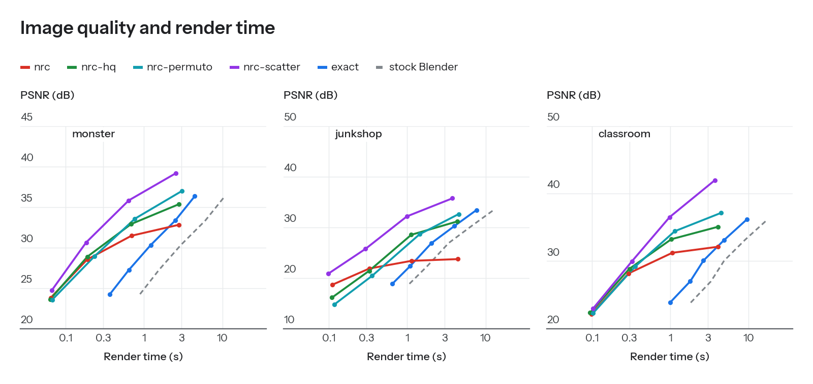

# RTX H100

[X post](https://x.com/wenhaocha1/status/2123597363335876818) · [Recipe](RECIPE.md) · [Baked caches](https://huggingface.co/wchai/cycles-h100-nrc-bake) · [Skills](skills/)


<sub>Stock Blender and this build render the three benchmark scenes for the same 30 seconds on one H100.</sub>

**A compute card can ray-trace like a graphics card.** On one NVIDIA H100, Blender 5.3.0 Cycles renders the Open Data benchmark at 55,148 samples per minute: 7.8 times stock Blender on the same card and 2.9 times an RTX 5090 with OptiX.

Exact per-scene kernel specialization gives the first 2.0 times. A per-scene baked neural radiance cache that ends every path at its first hit gives most of the rest. The first release, `nrc` at 48,641, asked the cache for the light arriving along one sampled bounce direction. `nrc-scatter` asks it for the light the first hit scatters toward the camera, so no bounce is sampled, and trains it on targets that average eight samples at the same hit; that gives 13% more samples per minute and cuts the noise the cache adds. It passes the 32-spp image gate on all three scenes. Wide BVHs, kernel concurrency and online cache training gave nothing. At the quality of an exact 32-spp render on every one of seeds 0 to 7, `nrc-scatter` delivers 10.3 times as many images per second as stock Blender, against 8.1 for `nrc`; at those low sample counts single images are off in mean brightness by up to 12%, from a sampling setting all cache configurations share. With that setting at Blender's default, every `nrc-scatter` image there is within 0.11% and it delivers 11.0 times stock Blender, at 16% fewer samples per minute. After a denoiser, the same setting decides: at Blender's default `nrc-scatter` reaches the quality of a denoised exact 32-spp render with 3.4 times as many images per second as `exact`, and with the published setting it is slower than `exact`.

## News

- **2026-11-22** After a denoiser: at scrambling distance 1.0 `nrc-scatter` reaches the denoised exact 32-spp quality at 44, 36 and 20 samples, 18.3 images per second against 5.40 for `exact`; with the published distances it needs 192 samples or more, or fails, because their frame-wide error survives the denoiser. [#11](https://github.com/wenhaochai/rtx-h100/pull/11)
- **2026-11-21** `nrc-scatter` at scrambling distance 1.0, Blender's default: at the bar every one of seeds 0 to 7 is within 0.11% of the reference brightness, against up to 12% off with the published distances, and it gives 32.4 images per second against 30.3, at 46,110 samples per minute instead of 55,148. The public scripts also rebuild the host and retrain the junkshop and classroom caches to the published results. [#10](https://github.com/wenhaochai/rtx-h100/pull/10)
- **2026-11-21** The bar over seeds 0 to 7: each cache configuration is now timed at the fewest samples where all eight seeds clear the 32-spp bar, and `nrc` renders other seeds with `SEED=1` cubins. `nrc-scatter` gives 30.3 images per second, 10.3 times stock Blender, and `nrc` 23.9. Its 13% more samples per minute than `nrc` come from the scattered query alone. [#9](https://github.com/wenhaochai/rtx-h100/pull/9)
- **2026-11-21** RTX PRO 6000 support: the `exact` and `nrc` configurations ported to the RTX PRO 6000 Blackwell (sm_120) and tuned there, plus an OptiX route on its RT cores. `nrc` at 78,297 samples per minute with OptiX and 74,847 with CUDA; `exact` at 19,942 with CUDA, 25,864 with OptiX; `nrc` gives 39.9 images per second at the 32-spp bar with OptiX, 6.1 times stock OptiX on the same card. [#7](https://github.com/wenhaochai/rtx-h100/pull/7)
- **2026-11-21** `nrc-scatter`: the cache answers the light the first hit scatters toward the camera and learns it from targets that average eight samples at that hit. 55,148 samples per minute, up from 48,641; 40.4 images per second at the 32-spp bar, up from 28.6. [#5](https://github.com/wenhaochai/rtx-h100/pull/5)
- **2026-11-21** Negative result: sampling K bounces and querying the cache K times per ending path cuts the cache's noise but costs more than it saves at the bar. [#4](https://github.com/wenhaochai/rtx-h100/pull/4)
- **2026-11-20** Negative result: the scattered query trained on one-sample targets shows where the low-sample noise comes from, but its caches are biased. [#3](https://github.com/wenhaochai/rtx-h100/pull/3)
- **2026-11-20** `nrc-permuto`: a permutohedral lattice cache over position and direction. Higher PSNR at high sample counts, slower at the bar. [#2](https://github.com/wenhaochai/rtx-h100/pull/2)
- **2026-11-20** `nrc-hq`: offline-baked caches, the trainer, and the cause of the cache bias. [#1](https://github.com/wenhaochai/rtx-h100/pull/1)
- **2026-11-20** First release: `nrc` at 48,641 samples per minute.

## Results

| samples per minute | monster | junkshop | classroom | total | image |
|---|---|---|---|---|---|
| stock Blender 5.3.0 | 2,768 | 2,450 | 1,824 | 7,041 | reference |
| RTX 5090, OptiX, Open Data median | | | | 19,202 | reference |
| `exact`: specialized kernels, no approximation | 6,706 | 4,050 | 3,356 | 14,106 | equal to stock up to floating-point rounding |
| `nrc`: + baked neural radiance cache | 20,275 | 13,319 | 15,047 | 48,641 | approximate, passes the image gate |
| `nrc-hq`: `nrc` with the offline-baked caches | 20,377 | 13,434 | 15,187 | 48,997 | approximate, passes the image gate |
| `nrc-permuto`: caches on a lattice over position and direction | 19,087 | 13,318 | 13,979 | 46,385 | approximate, passes the image gate |
| **`nrc-scatter`: the cache answers the light scattered at the first hit** | **23,367** | **15,375** | **16,406** | **55,148** | approximate, passes the image gate |
| `nrc-scatter` at scrambling distance 1.0 | 19,059 | 13,004 | 14,048 | 46,110 | approximate, passes the image gate and the luminance limit at the bar |

One H100 SXM 80 GB, official benchmark protocol. Per-scene values are medians over 6 to 12 three-scene runs; totals are as the project reported them, so they can differ from the column sum by a few units. Rebuilt and re-measured from this repository, `nrc` scores 48,721 and passes the same gate, and `exact` scores 14,116 with the same image difference. `nrc-hq` runs the same model, engine and cubins with caches baked offline from the same exact renders; it was measured on another node, so its difference from `nrc` is node spread. Its gate PSNR is 36.17, 32.00 and 35.63 dB, against 33.05, 23.80 and 32.31 dB for `nrc`. `nrc-permuto` puts the outgoing direction into the cache's grid, a permutohedral lattice, and runs it on a second engine in the same library; measured on a third node, its gate PSNR is 38.30, 34.24 and 38.09 dB. `nrc-scatter` runs its own cubins and hash caches trained on averaged targets on that engine; measured on a fourth node, its gate PSNR is 41.03, 37.02 and 46.01 dB. At scrambling distance 1.0, measured in one job with the published setting, which scored 55,105 there, its gate PSNR is 41.34, 37.02 and 45.97 dB.

| images per second at the 32-spp bar, seeds 0 to 7 | monster | junkshop | classroom | total | vs stock |
|---|---|---|---|---|---|
| stock Blender 5.3.0, 32 spp | 1.27 | 1.01 | 0.67 | 2.95 | 1.0x |
| `exact`, 32 spp | 2.68 | 1.57 | 1.07 | 5.32 | 1.8x |
| `nrc`, 24 / 24 / 32 spp | 10.8 | 6.82 | 6.28 | 23.9 | 8.1x |
| `nrc-hq`, 28 / 36 / 28 spp | 9.81 | 5.14 | 7.03 | 22.0 | 7.5x |
| `nrc-permuto`, 28 / 40 / 28 spp | 8.97 | 4.26 | 5.86 | 19.1 | 6.5x |
| **`nrc-scatter`, 20 / 16 / 24 spp** | **12.2** | **10.1** | **8.04** | **30.3** | **10.3x** |
| `nrc-scatter` at scrambling distance 1.0, 16 / 8 / 24 spp | 12.3 | 12.6 | 7.49 | 32.4 | 11.0x |

A sample of `nrc` does less work than a sample of stock Blender, so this table counts images instead: how many images per second reach the PSNR of an exact 32-spp render against the 65,536-spp reference, the gate's bar, on every one of seeds 0 to 7. A cache's sample count is the fewest, in steps of 4, at which all eight seeds clear the bar, and its value is one over the median render time of the eight renders, without scene load. All caches were measured on one node, `nrc`, `nrc-hq` and `nrc-permuto` with cubins that read the seed. `exact` and stock Blender sit on the bar at 32 samples, since it is their own mean. Seed 0 alone is a lucky draw for every cache: it clears the bar with up to 12 fewer samples, and the four caches give 28.7, 26.4, 20.8 and 40.6 images per second there. At the eight-seed counts the worst single image of each cache is off in mean luminance by 5.8 to 12%. That comes from the scrambling distance all cache configurations share; at Blender's default of 1.0 every `nrc-scatter` image is within 0.11%. RECIPE.md section 5 has the details.

| images per second after a denoiser, 3 of 3 sessions of 16 seeds | monster | junkshop | classroom | total | vs `exact` |
|---|---|---|---|---|---|
| `exact`, 32 spp | 2.65 | 1.59 | 1.16 | 5.40 | 1.0x |
| `nrc-scatter`, published distances, fails / 888 / 192 spp | 0 | 0.305 | 1.34 | 1.65 | 0.31x |
| **`nrc-scatter` at scrambling distance 1.0, 44 / 36 / 20 spp** | **6.04** | **4.67** | **7.58** | **18.3** | **3.4x** |

Here every image is denoised by Open Image Denoise 2.5.1 before it is checked, and the bar is the mean PSNR of eight denoised exact 32-spp renders against the same 65,536-spp reference. A session renders 16 images at new seeds in one Blender process; it passes when its mean PSNR clears the bar, within 0.05 dB, and its lowest image is within 0.2 dB of it. A configuration's sample count is the fewest at which three of three sessions pass, and its value is one over the median time per image. With the published distances `nrc-scatter`'s error is shared across the frame and the denoiser keeps it, so single images fall under the bar; `exact` with those distances fails at 32 samples too. RECIPE.md section 5 has the protocol and the details.

## How it got there


<sub>Every measured configuration of the project in order, with each new best named.</sub>

1. **Specialize the kernel to the scene, exactly.** Per-kernel launch bounds, the scene's own feature mask, eight times more paths in flight, a BVH traversal that refills idle lanes, and a shader interpreter with every unused node compiled out. The image stays equal to stock. 7,041 to 14,106.
2. **Approximate the sampling.** Stronger Russian roulette, a light threshold, cheaper indirect bounces, then more exact work on top: compile-time scene constants, flat leaf triangles, per-material shading programs, and a per-cell radiance cache. 14,106 to 27,041.
3. **Bake the lighting into a neural cache.** A hash grid and a small MLP per scene, trained offline on exact renders, frozen, and queried at the first hit of every camera path, where the path then ends. 27,041 to 48,641.
4. **Cache the scattered light.** The cache answers the light the first hit scatters toward the camera instead of the light along one sampled bounce, and learns it from targets that average eight samples at the hit. 48,641 to 55,148.

[RECIPE.md](RECIPE.md) has every step with its gain and image cost, the bake, the reproduction, and the fifteen ideas that failed.

## Samples per minute and image quality



<sub>Seed-0 renders on one H100, PSNR against the 65,536-spp exact reference. The cache lines have points at 16, 64, 256 and 1,024 samples; `exact` at 32 to 512. `nrc` is the production cache, `nrc-hq` the offline-baked one, `nrc-permuto` the lattice cache, `nrc-scatter` the scattered query on averaged targets. Render time is Cycles' render time without scene load, the median of three renders for every cache point and one render for `exact`. Stock Blender's time is the exact build's, scaled by the ratio of their samples per minute.</sub>

The benchmark counts samples, and a cached sample does far less work than an exact one, so samples per minute overstate how fast a usable image appears. Measured as image quality against render time, `nrc` clears the PSNR bar on all of seeds 0 to 7 at 24 to 32 samples, in 0.09 to 0.16 s: 4.0 to 5.9 times sooner than the exact build and 6.7 to 9.4 times sooner than stock Blender, which reach the bar at 32 samples. Its bias caps the quality near 33, 24 and 32 dB, so beyond about 1,000 samples the exact build gets there first and keeps improving; the benchmark score and the gate images both sit in that region. At those sample counts single images are off in mean luminance by up to 8%, past the gate's 0.5% limit, and the 9 to 18 minutes of baking per scene are not counted.

`nrc-hq` lifts that ceiling. At 1,024 samples it reaches 35.3, 31.2 and 35.1 dB, against 32.8, 23.7 and 32.1 dB for `nrc`, and it still gets there 1.3, 1.1 and 1.8 times sooner than the exact build. At 256 samples it is 3.3, 2.5 and 4.9 times sooner. At the 32-sample bar it is slower than `nrc`, mainly on junkshop, which needs 36 samples instead of 24; the three scenes give 22.0 images per second against 23.9.

`nrc-permuto` lifts it further with the same 64-wide network. At 1,024 samples it reaches 37.0, 32.6 and 37.1 dB, 1.7, 1.5 and 2.1 dB above `nrc-hq`. At the bar it is the slowest of the three published caches: at 32 samples its noise on junkshop stays at the exact build's level, and junkshop needs 40 samples. The three scenes give 19.1 images per second. RECIPE.md section 5 has the bias and variance split.

`nrc-scatter` has the highest PSNR of the four caches at every sample count. At 1,024 samples it reaches 39.2, 35.7 and 42.0 dB, 2.2, 3.1 and 4.8 dB above `nrc-permuto`. At 256 samples it reaches 35.8, 32.1 and 36.5 dB in 0.64 to 0.99 s; `exact` needs 512 samples and 4.5 to 9.5 s for 36.3, 33.4 and 36.2 dB. Its 32-sample noise is 1.4 to 6.1 times lower in linear luminance than `nrc-permuto`'s, so all of seeds 0 to 7 clear the bar at 20, 16 and 24 samples: 30.3 images per second, 10.3 times stock Blender.

## RTX PRO 6000

The same recipe on one NVIDIA RTX PRO 6000 Blackwell Server Edition (sm_120, 188 SMs, 96 GB). The card has RT cores, so every configuration runs two ways: the CUDA route, comparable with the H100 numbers, and an OptiX route that traces rays on the RT cores and shades with the same cubins. Same benchmark, same protocol, same baked `nrc` caches; per-scene medians over 9 runs on 3 GPUs.

| samples per minute | monster | junkshop | classroom | total | image |
|---|---|---|---|---|---|
| stock Blender 5.3.0, CUDA | 4,052 | 2,671 | 2,369 | 9,092 | reference |
| stock Blender 5.3.0, OptiX | 8,092 | 6,172 | 5,271 | 19,535 | reference |
| `exact`, CUDA | 9,790 | 5,502 | 4,650 | 19,942 | equal to stock CUDA up to floating-point rounding |
| `exact`, OptiX | 10,778 | 8,080 | 7,006 | 25,864 | equal to stock OptiX up to floating-point rounding |
| `nrc`, CUDA | 33,890 | 19,571 | 21,385 | 74,847 | approximate, passes the image gate |
| **`nrc`, OptiX** | **35,634** | **22,040** | **20,623** | **78,297** | approximate, passes the image gate |

| images per second at the 32-spp bar | monster | junkshop | classroom | total | vs stock, same device |
|---|---|---|---|---|---|
| stock Blender 5.3.0, CUDA, 32 spp | 1.65 | 1.04 | 0.77 | 3.46 | 1.0x |
| stock Blender 5.3.0, OptiX, 32 spp | 3.19 | 2.12 | 1.20 | 6.52 | 1.0x |
| `exact`, CUDA, 32 spp | 3.26 | 1.82 | 1.17 | 6.25 | 1.8x |
| `exact`, OptiX, 32 spp | 3.80 | 2.38 | 1.30 | 7.48 | 1.15x |
| `nrc`, CUDA, 16 / 20 / 20 spp | 18.2 | 8.9 | 10.0 | 37.1 | 10.7x |
| **`nrc`, OptiX, 16 / 20 / 20 spp** | **19.2** | **9.8** | **10.9** | **39.9** | **6.1x** |

Counted as the H100 table above was before it moved to seeds 0 to 7: images per second that reach the PSNR of an exact 32-spp render against the 65,536-spp reference, one over the median render time of three seed-0 renders at the fewest samples that clear the bar, without scene load. `nrc` clears it at 16, 20 and 20 samples on this card, against 20, 20 and 24 at seed 0 on the H100, and gives 39.9 images per second against 28.6 there at seed 0; its mean luminance at those counts is off by +1.8%, -1.3% and +5.0%. The CUDA and OptiX routes render the same `nrc` images. `nrc-scatter` (40.4 at seed 0 on the H100) is not ported yet: its inference engine, `nrc_infer.cu`, uses wgmma and builds for sm_90a only.

[RESULTS-rtxpro6000.md](RESULTS-rtxpro6000.md) has every step, the image checks and the reproduction.

## Reproduce

Needs an H100, the CUDA 12.9 toolkit, GCC 14, CMake, git-lfs, and Python 3 with numpy and OpenEXR. `$W` is one work directory.

```bash
scripts/fetch.sh $W                            # Blender source, benchmark data, baked caches
scripts/build_host.sh $W/blender $W/host       # headless Blender + patches/host.diff
scripts/build_engine.sh $W/engine              # the cache engine
scripts/kernel_tree.sh $W/blender $W/tree      # intern/cycles + patches/kernel/01..10
scripts/build_cubins.sh $W/tree/intern/cycles $W/nrc_cubins

export BENCH=$W/bench/blender-benchmark-launcher BLENDER=$W/host/install
export CUBINS=$W/nrc_cubins ENGINE=$W/engine/libcycles_nrc.so BAKES=$W/bakes
CUDA_VISIBLE_DEVICES=0 scripts/run.sh nrc bench out/nrc_1
```

For `nrc-hq`, run the same commands with `BAKES=$W/bakes_hq`. For `nrc-permuto`, add `BAKES=$W/bakes_permuto NRC_CONFIG=nrc/configs/run_infer.json`. For `nrc-scatter`, build `SCATTER=1 scripts/build_cubins.sh $W/tree/intern/cycles $W/scatter_cubins` and add `CUBINS=$W/scatter_cubins BAKES=$W/bakes_scatter NRC_CONFIG=nrc/configs/run_infer.json`. At scrambling distance 1.0, build with `SCATTER=1 SCRAMBLING=1.0` and run with `SCRAMBLING=1.0` too.

The `exact` configuration, the image gate, the exactness check and the Slurm job are in [RECIPE.md](RECIPE.md), sections 3 and 6.

## Skills

Four [Claude Code skills](skills/) distilled from how the work was done. Each is general, not tied to Cycles, and lists the traps this project actually hit.

- **[gpu-profile](skills/gpu-profile/SKILL.md)**: find where a CUDA workload's time goes before changing it. Split time per kernel, name the bound of each hot kernel, read registers and spills, and write an Amdahl table of what each lever can buy. Here that table showed early that no exact change could reach the RTX 5090, which moved the work to approximation.
- **[kernel-specialize](skills/kernel-specialize/SKILL.md)**: build per-input kernels whose output does not change: launch bounds, feature masks, dead-code pruning, compile-time constants, every change behind a macro. This gave the 2.0x of the exact track. Its main trap: a binary with folded constants ignores later settings, and 22 sweeps on such binaries measured nothing.
- **[quality-gate](skills/quality-gate/SKILL.md)**: accept an approximation only against a reference far better than both sides, a bar set by a cheap exact baseline, and a bias limit, and check the gain per unit of quality, not per sample. Here the cache more than tripled samples per minute, but its quality levelled off, and above that level the exact build produced the same image sooner.
- **[cache-bake](skills/cache-bake/SKILL.md)**: train a per-scene neural cache offline on unbiased targets, calibrate it on held-out seeds, freeze it, and choose where paths query it. Online training left a smooth bias, and more network capacity did not remove it.

## Future work

- **More scenes.** Every gain here is fit to the three benchmark scenes. The next step is scenes the method has not seen: derive the per-scene kernel choices from scene content, which already matched hand tuning on the exact track, and make the bake part of loading a new scene.
- **More hardware.** The kernels, launch bounds and register budgets are tuned for one H100. The same recipe should run on other compute and graphics GPUs, starting with the H200 and B200, where the balance between memory, registers and RT cores differs. The RTX PRO 6000 port above is the first: it needed a different register budget and an OptiX route.

## Citation

```bibtex
@misc{chai2026rtxh100,
  title  = {{RTX H100}: Blender Cycles on One {H100}},
  author = {Chai, Wenhao and Chen, Liyan and Li, Zhifei and Guo, Wentao and
            You, Jiacheng and Li, Kunjun and Wei, Qingfu and Peng, Bo},
  year   = {2026},
  howpublished = {\url{https://github.com/wenhaochai/rtx-h100}}
}
```

## License

Apache-2.0, as Blender Cycles, which the patches modify. `nrc/patches` modify tiny-cuda-nn and CUTLASS, both BSD-3-Clause. The benchmark scenes in the animation are the Blender Open Data benchmark scenes, by their respective authors.
